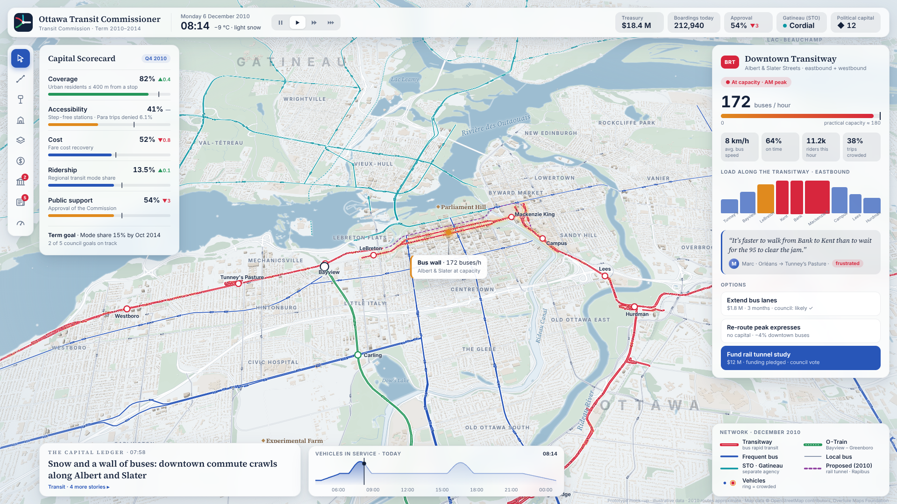

# Ottawa Transit Commissioner (OTC)

A browser-based transit simulator set in the real Ottawa–Gatineau region. It starts in December
2010: you chair Ottawa's Transit Commission and redesign the capital's transit system, balancing
coverage, accessibility, cost, ridership and public support. Gatineau's STO runs separately, with
its own agenda. The whole thing plays out on an elegant, living 2.5D map.

**Status:** planning and visual design.

- [`docs/PLAN.md`](docs/PLAN.md): game design and technical plan
- [`docs/VISUAL_DESIGN.md`](docs/VISUAL_DESIGN.md): the look, with prototype screenshots
- [`prototype/visual/`](prototype/visual/): the visual prototype that renders those screenshots

Map data © OpenStreetMap contributors and the Overture Maps Foundation.
