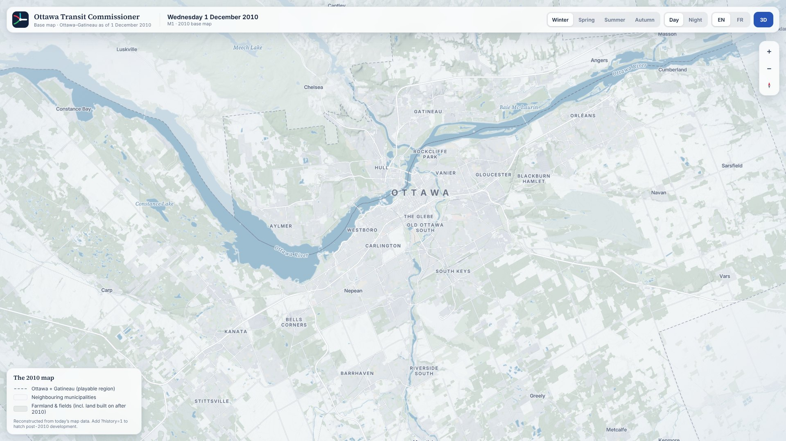
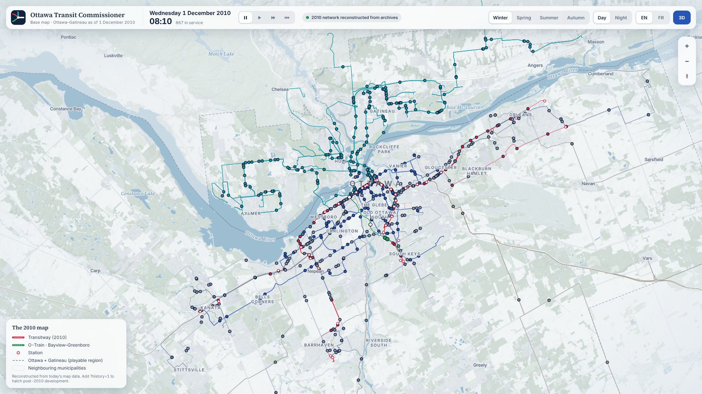

# Ottawa Transit Commissioner (OTC)

A browser-based transit simulator set in the real Ottawa–Gatineau region. It starts in December
2010: you chair Ottawa's Transit Commission and redesign the capital's transit system, balancing
coverage, accessibility, cost, ridership and public support. Gatineau's STO runs separately, with
its own agenda. The whole thing plays out on an elegant, living 2.5D map. It runs in the browser
on desktop, iPad and phone.



**Status:**

- M0 (project skeleton) and M1 (the 2010 base map) are done.
- M2 is done. The whole 2010 OC Transpo and STO network runs on a game clock: 217 routes,
  about 13,500 weekday trips and ~900 buses at the morning peak.
  - The Transitway routes and the O-Train follow dated archive sources.
  - The rest of the November 2010 route tables is approximated well enough for a game.



See the [roadmap](docs/PLAN.md#12-roadmap).

## Run it

```bash
pnpm install                                   # Node 20+ and pnpm 10
(cd pipeline && uv sync && uv run otc-pipeline all)   # builds the 2010 map data (~3 min, needs internet)
pnpm dev                                       # http://127.0.0.1:5173
```

URL options:

- `?season=winter|spring|summer|autumn`
- `&time=day|night`
- `&lang=en|fr`
- `&3d=0`
- `&history=1` hatches post-2010 development
- `&layout=phone|tablet|desktop`
- `&t=HH:MM` sets the start time
- `&speed=0..3` sets the speed (pause, then 1, 5 or 15 min/s)
- `&select=stop:carleton|route:oct-otrain|vehicle:oct-otrain` opens an inspector

The camera position is kept in `#view=zoom/lat/lng/bearing/pitch`.

## Repository

| Path | What |
|---|---|
| [`apps/web`](apps/web) | The game client: Vite, React, MapLibre GL and PMTiles; responsive desktop, iPad and phone layouts |
| [`packages/shared`](packages/shared) | Region definition and the vector-tile contract (`tile-schema.json`) shared with the pipeline |
| [`packages/sim`](packages/sim) | Simulation core: weekday timetables and vehicle playback (M2); demand and the rest come later |
| [`pipeline`](pipeline) | Python data pipeline: Overture data and NRCan elevation, reconstructed to the 2010 city, written as PMTiles |
| [`docs`](docs) | [Plan](docs/PLAN.md) and [visual design](docs/VISUAL_DESIGN.md) |
| [`prototype/visual`](prototype/visual) | The throwaway visual prototype behind the design screenshots |

Checks: `pnpm check` (typecheck, test, build) and `cd pipeline && uv run pytest`. CI runs both.

Map data © OpenStreetMap contributors and the Overture Maps Foundation. Elevation © Natural
Resources Canada. Fonts are under the SIL OFL.
