# Ottawa Transit Commissioner (OTC)

A browser-based transit simulator set in the real Ottawa–Gatineau region. It starts in December
2010: you chair Ottawa's Transit Commission and redesign the capital's transit system, balancing
coverage, accessibility, cost, ridership and public support. Gatineau's STO runs separately, with
its own agenda. The whole thing plays out on an elegant, living 2.5D map. It runs in the browser
on desktop, iPad and phone.

**▶ Play it: <https://forward6.github.io/public--transit/>** (desktop, iPad and phone). It's
rebuilt and republished on every push by `.github/workflows/pages.yml`.


**Status:**

- M0 (project skeleton) and M1 (the 2010 base map) are done.
- M2 is done. The whole OC Transpo and STO network runs on a game clock: 226 routes, about
  12,400 weekday trips, 6,400 stops and ~880 buses at the morning peak.
  - **OC Transpo** runs to its own timetable: 148 routes and every stop, from the closest feed the
    Internet Archive preserved. That's August 2011, just before the September 2011 restructuring.
  - **STO** and the few OC Transpo routes missing from that feed are approximated from the
    November 2010 route tables.
- M3 is under way, and people ride. A first demand model gives 2.87 million weekday trips, 13.7% of
  them by transit, and about 580,000 boardings, calibrated to 2011
  ([report](docs/calibration/2011.md)). Open the **Ridership** panel from the top bar, or switch
  on **Riders** to see where people travel.
- M4 is under way: the first playable version. Press **Plan** to:
  - change any route's service, or remove it;
  - draw new routes on the map (they follow the streets and get stops automatically);
  - see travel times from anywhere;
  - **Evaluate** your plan on a Scorecard against 2010 (riders, coverage, jobs within reach,
    cost).

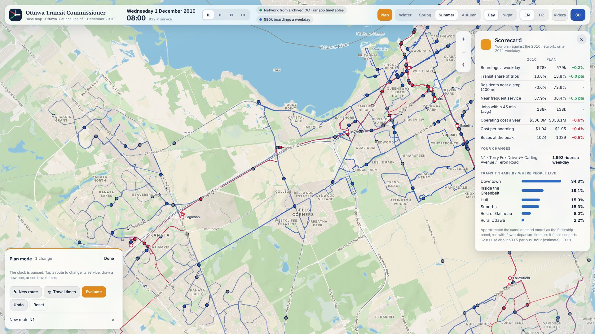

- M5 is under way: money and fleet.
  - **The campaign** starts at 00:01 on Wednesday 1 December 2010, with the 2011 budget to set.
  - **The calendar runs on the clock.** Watch a day in real time, or speed up to 2 hours or
    1 day per second to watch the weeks go by. The season follows the date, and night falls at
    Ottawa's real sunset. Weekends and holidays run fewer buses and carry fewer riders.
  - **Your plans** take effect at the next service change. The demand model measures them when
    you schedule them. Riders then find new service over a few weeks, and leave a cut route
    within days.
  - **Riders day by day:** the top bar shows yesterday's riders against the same day last week.
    The **Ridership** panel charts the last twelve weeks with each service change marked, and
    follows the routes your changes touched.
  - **The books:** tap the **Reserve** chip to see revenue and costs, and to order buses or
    build garages.
  - **Each autumn** brings a budget. Run out of money and you must choose: raise the levy, cut
    service, defer maintenance or borrow.

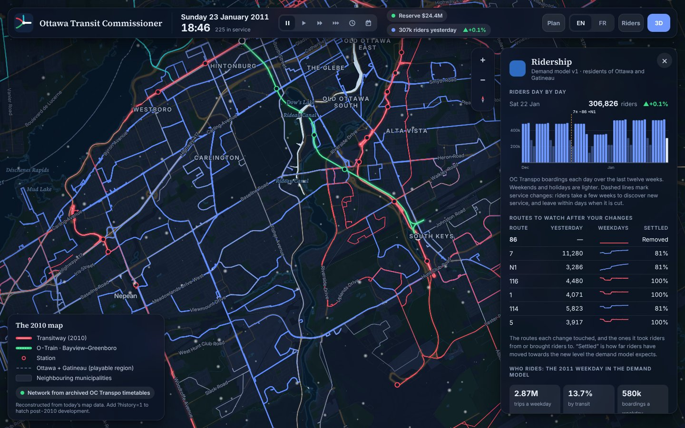

- M6 (v1) is done: opinion and media.
  - **The public reacts.** Every Ottawa neighbourhood has an opinion of the Commission (service,
    value for money, trust) that moves day by day with service, reliability, crowding, the
    weather, fares, taxes and the news. Tap the **Approval** chip, or switch on **Opinion** to see
    it on the map; every number has a "why".
  - **Follow a rider:** six fictional riders, from Marc's Orléans commute to Lise's missing bus in
    Manotick, ride the real network and keep diaries.
  - **The papers:** a front page every month, and a feed of what people are saying.
- **Where the load is:** switch on **Riders** for peak crowding. Every stretch shows its morning
  peak-hour riders against the places on the buses and trains scheduled through it (all routes
  together), from room to spare to over capacity, for the network in operation. The **Where the load
  is** panel lists the busiest and most crowded stretches, the routes under pressure and the busiest
  stations.

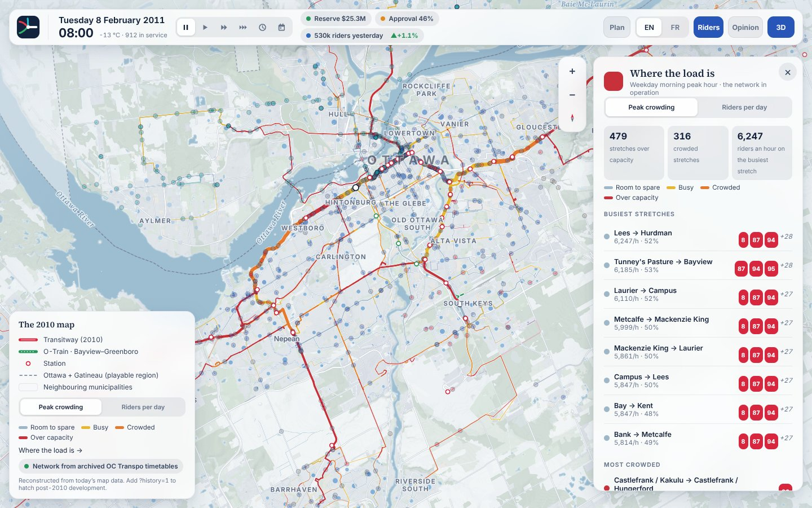

- M7 (v1) is done: council, elections and partners. Only the big items go to a vote:
  - **the budget and deficit choices** go to council; **plans that add or remove routes** go to the
    Transit Commission first, with a staff report on what each ward gains or loses; **big bus orders and
    garages** go to council;
  - before each vote you see the **whip count**: every councillor's likely vote and their reason.
    Spend **Political Capital** to lobby (it comes from approval and delivered promises, and fades
    if you sit on it), hold consultations or commission a study to buy a month, amend, or withdraw;
  - **the council is split** (8 lean your way, 9 in the middle, 7 fiscal hawks). Lose votes and
    council writes its own budget, passes motions to bring back routes you cut, and reshuffles your
    Commission;
  - **contract talks** with the (fictional) union open in February 2011, with Ottawa still
    remembering the 51-day strike of 2008–09. A deal needs council's ratification; failed talks
    can end in a strike;
  - **partners:** Gatineau's STO is a light-touch partner with its own agenda (fare integration,
    shared stops, the Rapibus, a new council in 2013); the Province and the federal government offer
    money with strings attached (a third of each new bus if fares stay down; $30M toward a garage
    built by June 2013); the NCC reviews new routes on its parkways;
  - **election night,** 27 October 2014: the wards come in one by one, and the new council sets how
    hard the next term will be.

- **A start screen:** continue the campaign saved in this browser (it shows the date, approval and
  reserve), or start a new game (after a confirmation). Tap the logo during the game to get back to
  it.
- **Riders on board:** tap a bus or train to see how many people are on it now, against its seats
  and room, and how many are on board as it leaves each coming stop. Estimated from the demand
  model: a route's riders between two stops are shared between its trips by time of day (commuters
  ride inbound in the morning and outbound in the evening) and how often the buses come, scaled to
  today's riders (season, weather, weekends).

- M8 (v1) is under way: big projects. In Plan mode, draw a **light-rail line**, a **Transitway
  busway** or a **commuter rail line**, anywhere in the region, across the Ottawa River included:
  - tap the map to place stations (near an existing station, they share it for transfers), and
    choose for each stretch whether it runs on the surface, elevated or in a tunnel;
  - the estimate updates as you draw: cost (light rail about $35M a km on the surface, $260M in a
    tunnel, $150M on a bridge, plus stations, trains and a yard; commuter rail $4M a km to upgrade
    an existing railway, which the map shows dashed while you draw), years to opening, running cost;
    **Forecast riders** runs the demand model on it;
  - **crossing the river** needs a bridge or a tunnel: Quebec may pay a quarter if Gatineau and the
    STO sign on, the NCC sets conditions, and the old Prince of Wales rail bridge is far cheaper to
    rehabilitate than a new bridge;
  - timelines are **compressed** (about 0.4× real ones), so even a downtown tunnel opens within your
    first term;
  - **council votes twice**: to pay for design and the environmental assessment, then to award
    the contract once the bids are in. In between, Ontario and the federal government decide
    whether to pay a third each (likelier for more riders per dollar; you can ask again), and you
    choose a **public build** (cheaper, but overruns are yours) or a **public-private
    partnership** (dearer, but the consortium carries most of the risk);
  - **construction** takes years: money goes out month by month (partners, development charges,
    then 30-year borrowing that the levy must cover), neighbourhoods along the line put up with
    detours, and setbacks happen (overruns you deal with, delays, a sinkhole in a tunnel);
  - **opening day:** the line joins the network, riders try it (smoothly or not), and you can
    rework the bus routes that run alongside it.

  - drawing a line, every change can be **undone and redone** (⌘Z / Ctrl+Z); **Close** keeps the
    draft for later (in this browser), **Discard draft** asks first.
- **Streetcars** (M8): a fourth mode, drawn stop by stop along the streets (each stretch follows the
  2010 streets between the stops you place). Each stretch runs **in traffic** (about bus speed:
  lights and traffic) or **in its own lane** with signal priority (faster, dearer, a lane taken from
  cars). About $14M a km in traffic, $20M in its own lane, plus cars and a small yard; the street is
  dug up for longer, since the utilities under it move first.
- **Growth** (M9 v1): the city grows after 2010, and where depends on what you do.
  - Each month the region adds about 1.3% residents and 0.9% jobs a year (a little more when transit
    lets more people reach more jobs). A land-use model places them where people can **reach jobs**
    by car and by transit (the network running now), where there is **room to build** (the
    suburban edge has plenty; the core redevelops slowly, a little faster where transit improved),
    near rapid-transit **stations** where the zoning allows (developers pay more, most for a new
    line's), and **not beside construction** (homes wait, some shops close while a street is torn
    up).
  - A line that is no faster than the bus it replaces (a streetcar in traffic, say) adds little
    reach, so it draws little growth; its construction still costs the businesses along it. The
    real lever is **zoning**: developers offer to build near stations if council rezones (a vote:
    homes near transit and development charges against the neighbours).
  - New residents and jobs bring riders as their neighbourhoods use transit.
  - **Growth** view (top bar): the map washed by new residents and jobs since 2010, zones beside
    construction outlined; the Growth panel shows where growth went (near stations, the core, the
    suburban edge, Gatineau, rural), month by month, the fastest-growing places, developers' offers
    and what draws growth. Tap a zone: then and now, room left, reach by transit and by car, and why
    it grows (or doesn't).
- **+1 month**: plays the rest of the month at once (stopping at a decision), then shows the **month
  in review**: weekday riders, approval, reserves, Political Capital, riders from growth, new
  residents and jobs and where they went, and what happened. Another month, or see where it grew.
- Coming back to the game, it now plays at **real time** (▶); speed it up when you want.
- **Operations, right now:** tap the **"in service" chip** in the top bar (under the reserve on an iPad,
  in the sheet on a phone). Buses and trains running, riders on
  board (estimated), places running against the whole fleet's, buses spare at the garage or **in the
  shop** (maintenance and breakdowns: about 7%, more with a maintenance backlog and older buses), the
  peak need against what can run, trains by line, missed trips, the fullest vehicles (tap to follow),
  and the day's curve of vehicles on the road.

- **Settings** (the gear at the end of the top bar): language (English or French), 3D buildings and
  terrain (off for a flat map that runs faster on older devices), and the main menu.

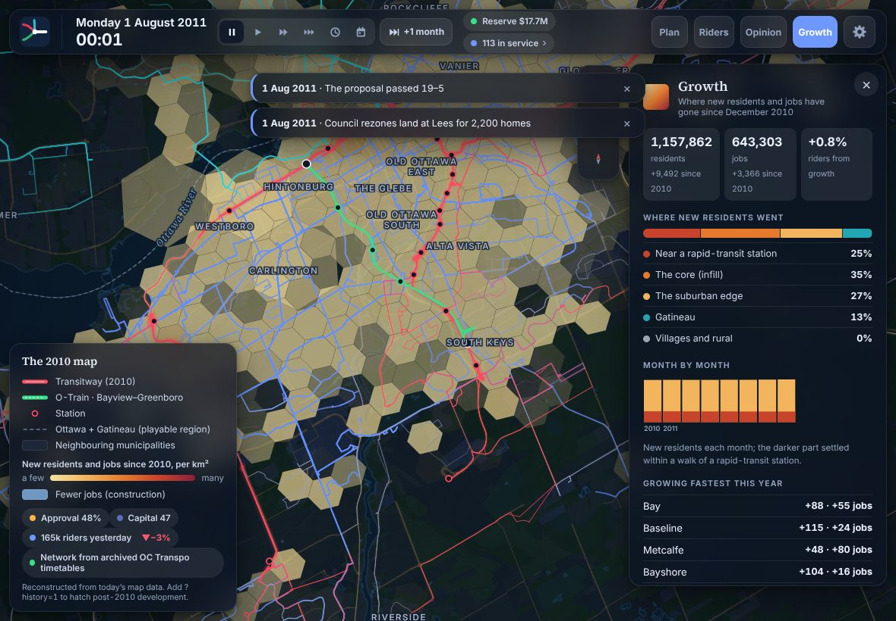

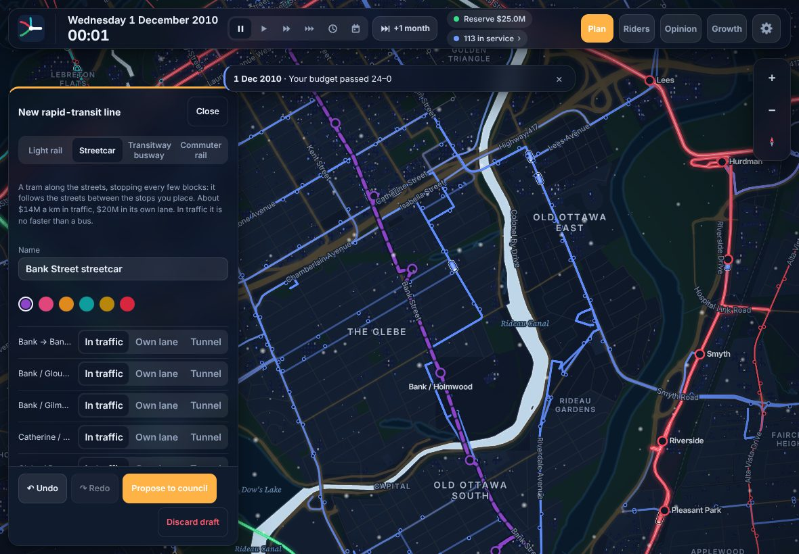

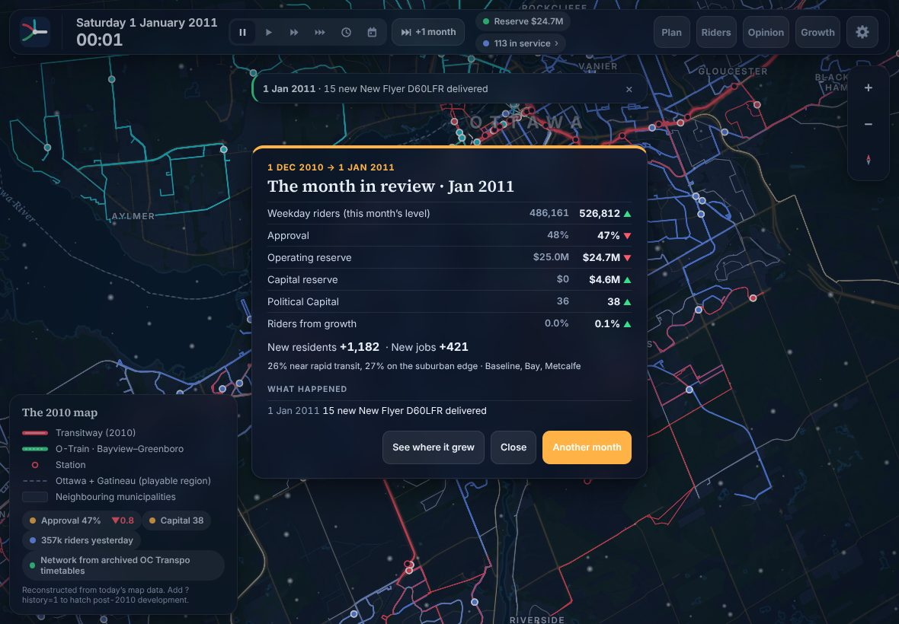

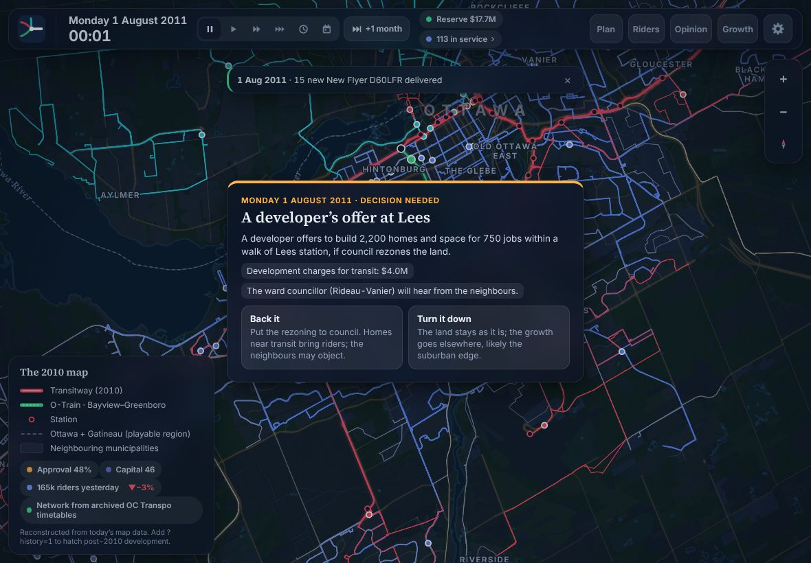

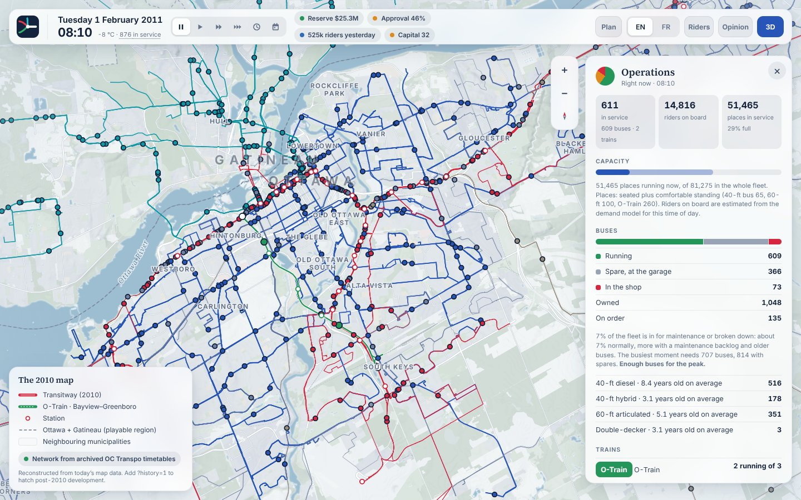

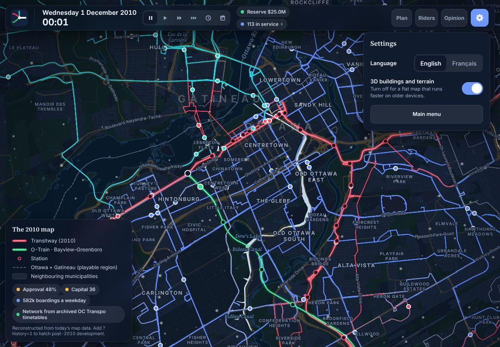

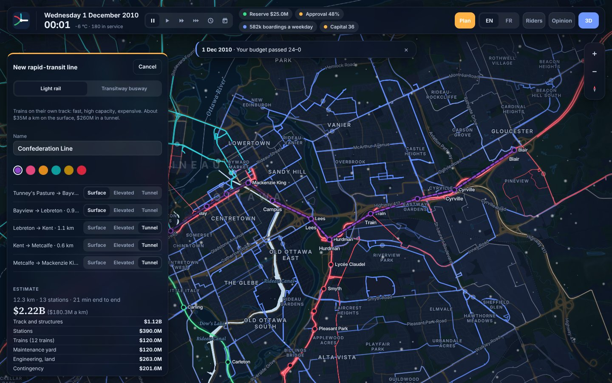

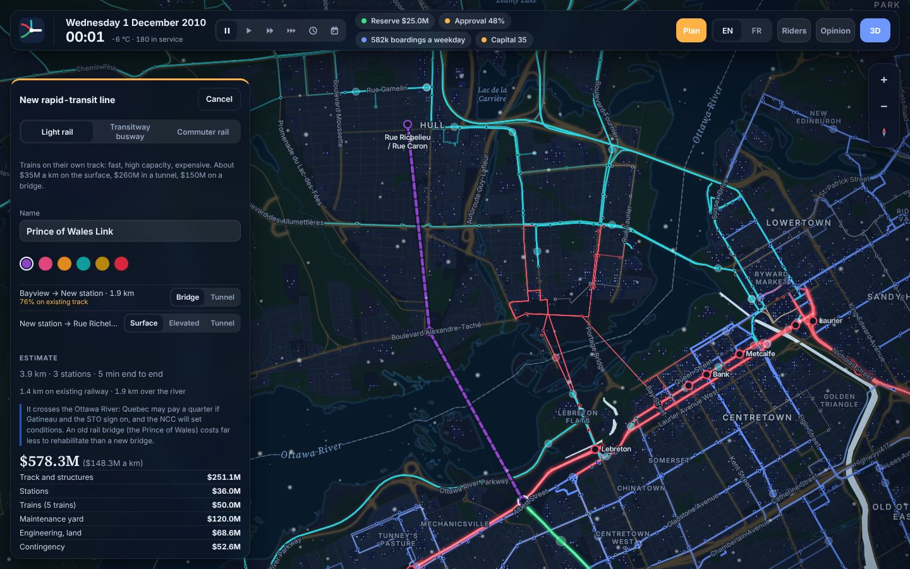

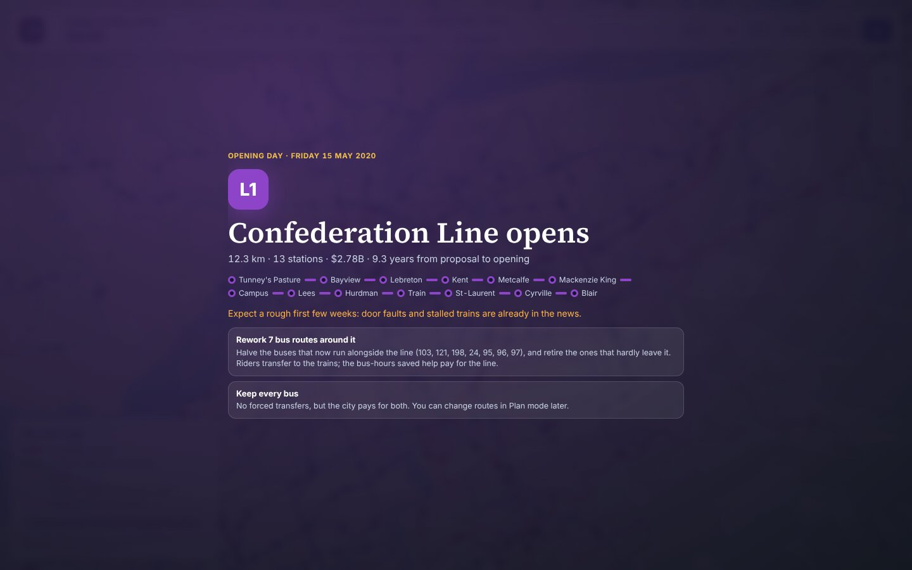

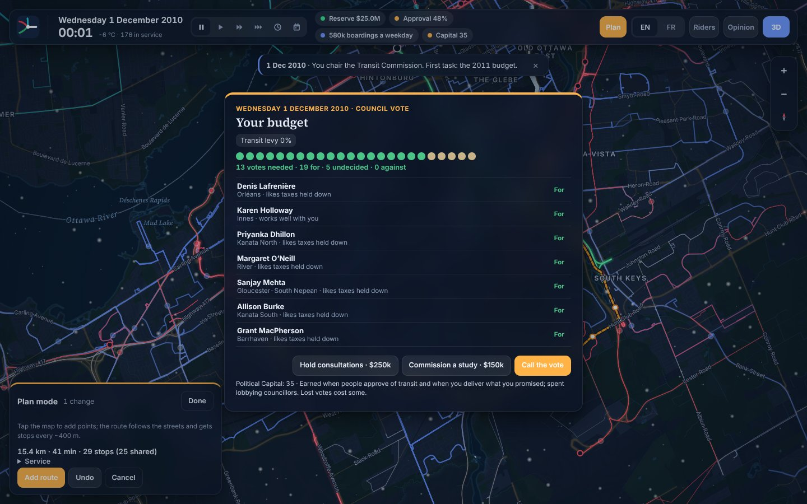

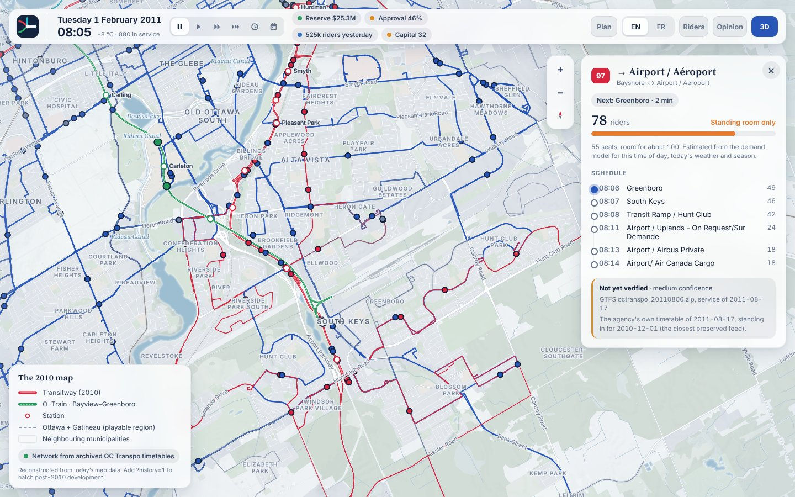

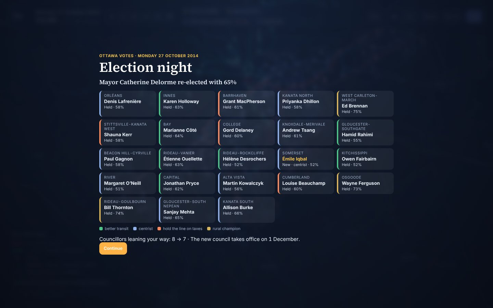

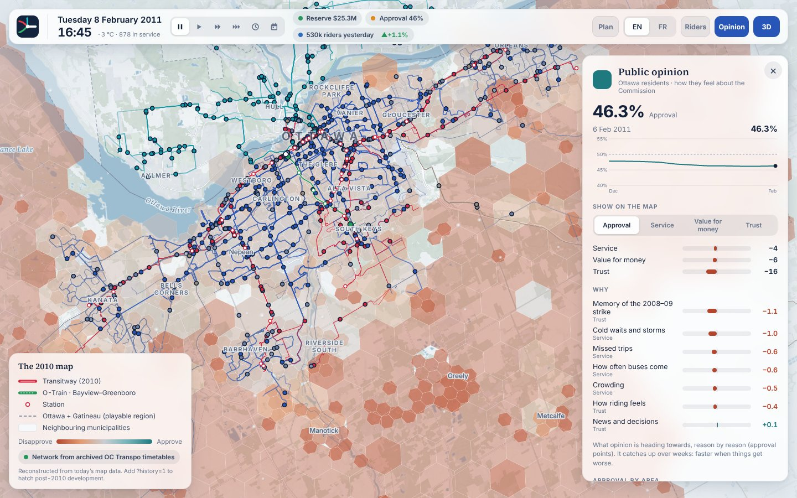

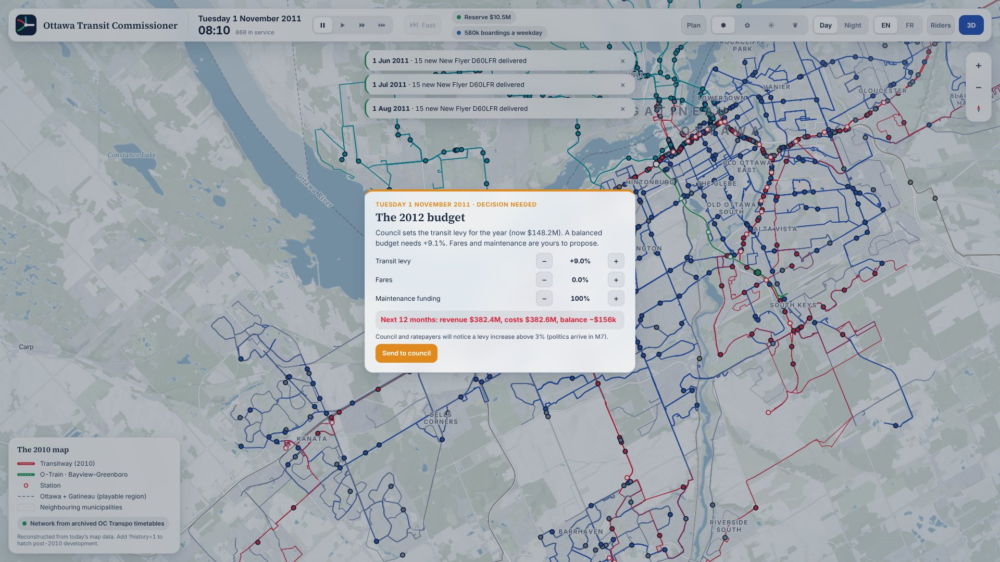


See the [roadmap](docs/PLAN.md#12-roadmap).

## Run it

```bash
pnpm install                                   # Node 20+ and pnpm 10
(cd pipeline && uv sync && uv run otc-pipeline all)   # builds the 2010 map data (~3 min, needs internet)
pnpm dev                                       # http://127.0.0.1:5173
```

URL options (any option but `lang` opens straight into the game, without the start screen):

- `?lang=en|fr`
- `&menu=1` shows the start screen anyway; `&menu=0` skips it
- `&season=winter|spring|summer|autumn` and `&time=day|night` pin the look (the calendar and the
  sun set it otherwise)
- `&3d=0`
- `&history=1` hatches post-2010 development
- `&layout=phone|tablet|desktop`
- `&t=HH:MM` sets the time of day (a new game starts at 00:01; a saved one resumes where it was)
- `&speed=0..5` sets the speed: pause, real time, 1 min/s, 15 min/s (the default), 2 h/s, 1 day/s
- `&select=stop:carleton|route:oct-otrain|vehicle:oct-otrain|persona:marc|opinion:city|load:peak` opens an inspector
- `&riders=1` turns on the Riders view (peak crowding; `&rv=daily` for riders per day); `&opinion=1` the Opinion view (`&ov=ward|service|value|trust` for wards or an axis)
- `&select=ops:now` opens the Operations panel; `&select=council:term` the Council panel; `&select=project:line-1` a line's panel (`project:all` the list)
- `&plan=1&line=lon,lat;lon,lat;…` draws a rapid-transit line (`&linemode=busway`, `&tunnel=2,3` for stretches in a tunnel, `&linename=…`)
- `&plan=1` opens Plan mode. Add `&iso=lon,lat` for travel times from a point, or
  `&draw=lon,lat;lon,lat;…` to sketch a route.

The camera position is kept in `#view=zoom/lat/lng/bearing/pitch`.

## Repository

| Path | What |
|---|---|
| [`apps/web`](apps/web) | The game client: Vite, React, MapLibre GL and PMTiles; responsive desktop, iPad and phone layouts |
| [`packages/shared`](packages/shared) | Region definition and the vector-tile contract (`tile-schema.json`) shared with the pipeline |
| [`packages/sim`](packages/sim) | Simulation core: weekday timetables and vehicle playback (M2); RAPTOR routing, the demand model and transit assignment (M3) |
| [`pipeline`](pipeline) | Python data pipeline: Overture data and NRCan elevation, reconstructed to the 2010 city, written as PMTiles |
| [`docs`](docs) | [Plan](docs/PLAN.md) and [visual design](docs/VISUAL_DESIGN.md) |
| [`prototype/visual`](prototype/visual) | The throwaway visual prototype behind the design screenshots |

Checks: `pnpm check` (typecheck, test, build) and `cd pipeline && uv run pytest`. CI runs both.
The *Publish the game* workflow builds the map data with `otc-pipeline all` on GitHub's servers
and publishes the app to GitHub Pages. It needs one setting: Settings → Pages → Source: GitHub
Actions.

Map data © OpenStreetMap contributors and the Overture Maps Foundation. Elevation © Natural
Resources Canada. Fonts are under the SIL OFL.
