# Ottawa Transit Commissioner (OTC): Visual Design

**v0.2 · 1 November 2026** · Companion to [`PLAN.md`](PLAN.md) §9

This document defines how OTC looks on **desktop, iPad and phone**. Every screenshot below was
rendered from the working prototype in [`prototype/visual/`](../prototype/visual/), using real
Ottawa–Gatineau geometry, in the browser stack the game will use (MapLibre GL).

### Locked decisions

| Topic | Decision |
|---|---|
| Default look | **Calm.** The cartographic overview is the default. The cinematic look switches on when you zoom into a corridor (§4). |
| Colours | **Real-world:** OC Transpo Transitway red, O-Train green, STO teal (§3). |
| HUD density | **As shown.** The amount of on-screen information is right; keep it. |
| Agency names | **Real names** in the UI: OC Transpo, STO, Para Transpo, Transitway, O-Train. No real logos. |
| Devices | **Desktop, iPad and phone**, with one codebase and three layouts (§12). |

> **About the screenshots.** The basemap is real (streets, rivers, parks, building footprints and
> heights). The 2010 routes are a careful *approximation* drawn for this mock-up. Every number in
> the HUD (budgets, approval, riders, council counts) is an illustrative placeholder, not
> simulation output.

---

## 1. Screenshots

### 1.1 Winter morning: the overview (Monday 6 December 2010, 08:14)

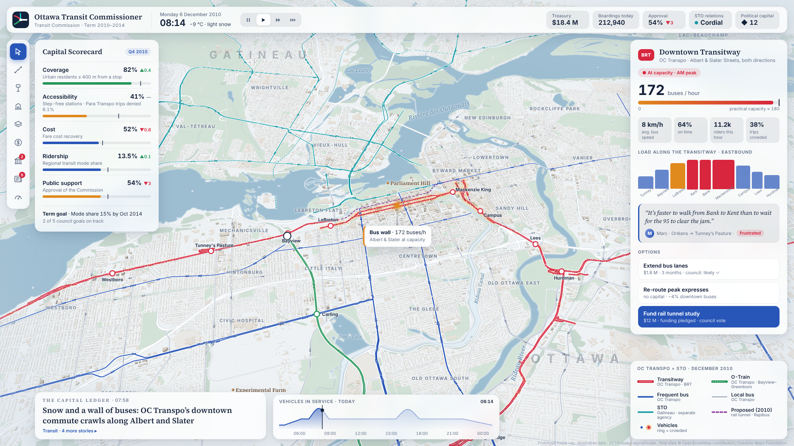

*The first week of the campaign.* This is the default "playing" camera: top-down with a gentle
tilt, showing the whole core from Westboro to Vanier and from Hull to the Glebe.

- **Map:** snow-white land, shore ice along the Ottawa River, the frozen Rideau Canal, and
  warm-stone buildings.
- **Network:** the 2010 Transitway (red, with a white centre line) runs into downtown on Albert
  and Slater. The original O-Train (green, dashed centre) runs Bayview–Carleton. Frequent buses are
  blue and local buses are grey-blue. **STO's Gatineau routes are teal**: a separate agency, and
  visibly so.
- **Proposals:** the planned downtown rail tunnel (approved in principle in 2010) is shown dashed
  purple.
- **The selected corridor** glows amber. A callout flags the problem: the **"bus wall"**.
- **HUD:** the Capital Scorecard (left), the corridor inspector (right), a newspaper headline, a
  "vehicles in service" day curve, and the legend.

### 1.2 Winter night: the close-up (Thursday 16 December 2010, 17:42)

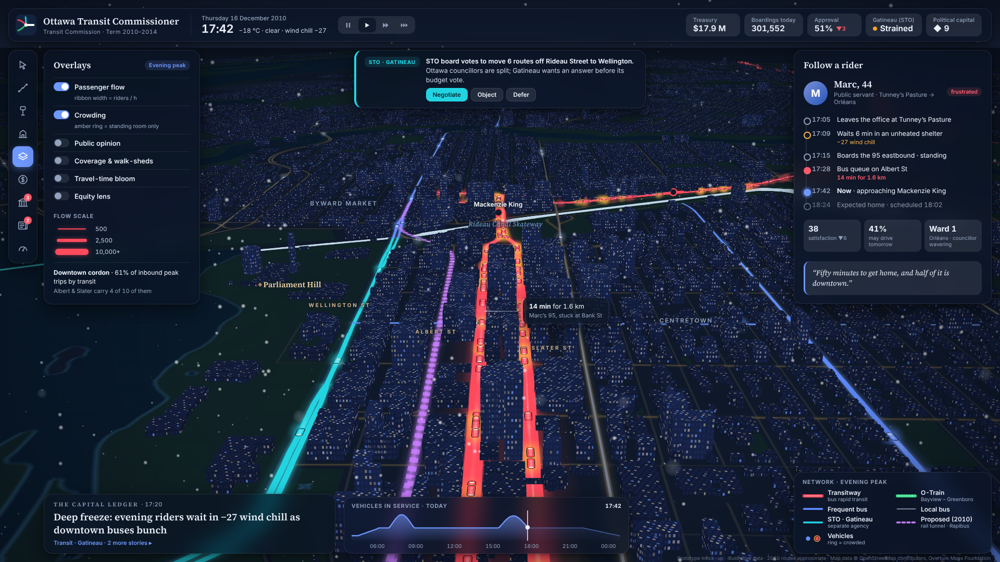

*Zoom into the problem.* The camera tilts to 72° and looks east down the **Albert/Slater canyon**
toward Mackenzie King.

- **Towers:** lit windows, and they correctly hide the street light behind them.
- **Flow ribbons:** the passenger-flow overlay sets line width by riders per hour. The Transitway
  is a double ribbon of queued buses.
- **Landmarks:** the frozen **Rideau Canal Skateway** glows across the far end, and Parliament Hill
  sits to the left.
- **Follow a rider:** Marc's evening commute, minute by minute.
- **Gatineau politics:** a toast reports that STO has moved routes without asking.

### 1.3 Summer planning: drawing a proposal (Tuesday 14 June 2011, 10:20, paused)

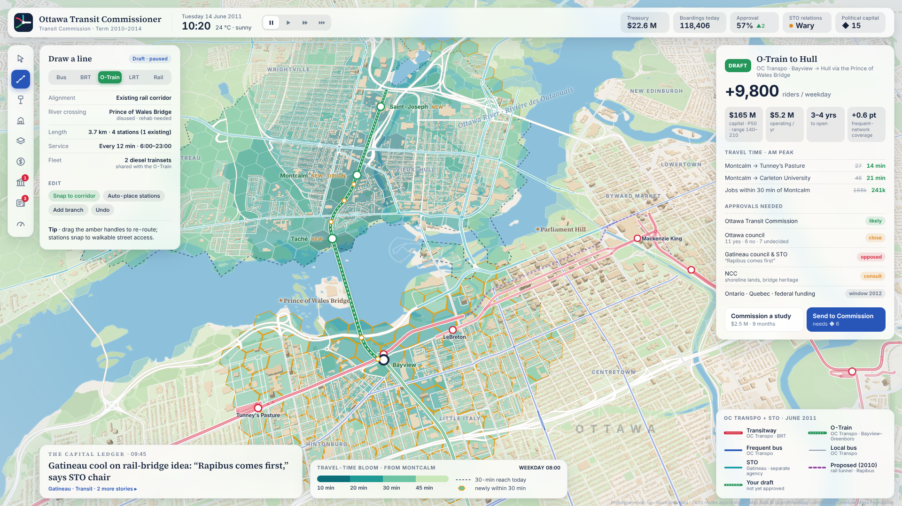

*The design tools.* The game is paused in planning mode.

- **Palette:** the summer "Limestone" palette (cream land, green parks, blue water).
- **Muted network:** the existing network fades back so the work stands out.
- **The draft:** the player has sketched an **O-Train extension from Bayview across the disused
  Prince of Wales rail bridge into Hull**. It has a white casing, marching-ants dashes, amber edit
  handles, and new stations marked *NEW*.
- **Travel-time bloom:** coloured hexagons show how far you can get from Montcalm in 10, 20, 30
  and 45 minutes.
  - The dashed line is the 30-minute reach today.
  - Amber outlines mark neighbourhoods the draft brings newly within 30 minutes.
- **Impact panel (right):** riders, cost, travel times, and every approval the draft needs.
  Gatineau's council is opposed ("Rapibus comes first"). Its separate agenda is a gameplay obstacle.

### 1.4 iPhone: portrait, one-handed

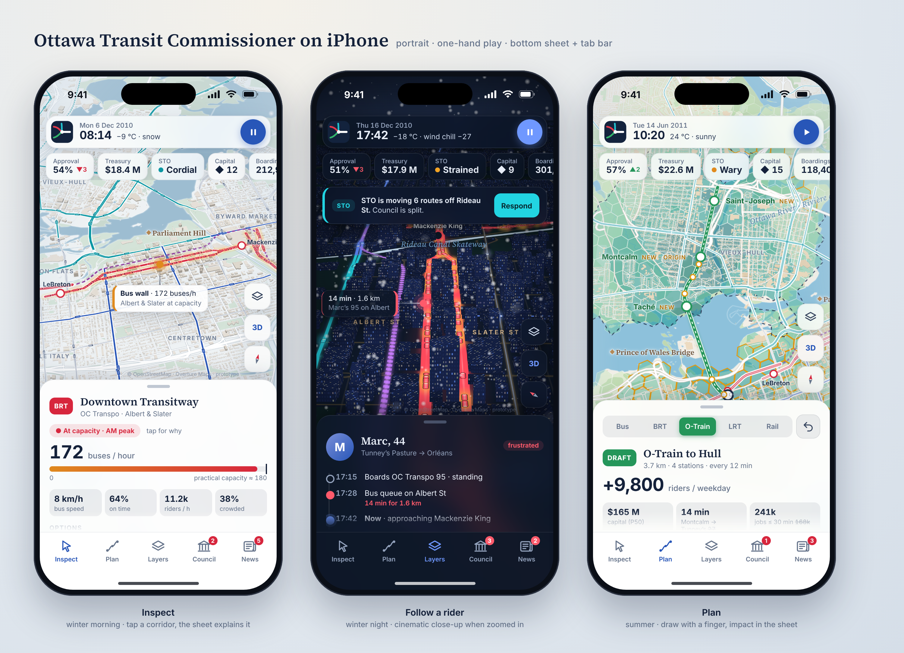

The same three moments on a phone. The map fills the screen, and everything else is shared out:

- **Top:** a status capsule (date, time, weather, a big play/pause button) and a row of KPI chips
  you can swipe. The chips include STO relations.
- **Bottom:** a **sheet** holds whatever the side panels showed on desktop: corridor details, the
  rider you're following, or the draft's impact. Below it is an iOS-style **tab bar** (Inspect,
  Plan, Layers, Council, News).
- **Partner events** such as STO's move appear as a compact banner with a single *Respond* button.
- **Right edge:** floating buttons for layers, 3D tilt and the compass.

### 1.5 iPad: landscape, with Apple Pencil

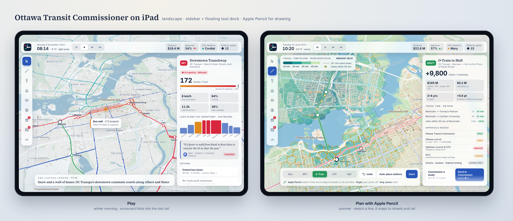

The iPad keeps the desktop structure but makes it lighter:

- **Panels:** the top bar loses the wordmark and one KPI. The Capital Scorecard folds into the tool
  rail. The right panel becomes a full-height sidebar that scrolls.
- **Planning:** the draw tools move to a **floating dock** at the bottom (mode switch, Undo,
  Auto-place stations, Done), and the bloom legend floats top-left.
- **Apple Pencil sketches lines** that snap to streets or rail corridors. A finger pans, pinches and
  tilts.

---

## 2. Design principles

1. **Cartography first.** It should read like a beautifully printed city map that has come alive.
   Hierarchy comes from line weight, spacing and restraint, not from icons or noise.
2. **Transit is the hero.** The basemap is quiet and low-contrast, and the network carries the
   colour. At any zoom, the eye goes to the lines and the vehicles.
3. **Real place, readable game.**
   - Geography is exact.
   - Symbology is simplified.
   - When realism hurts readability, readability wins. For example, the overview draws transit
     *over* buildings, while the close-up lets towers hide it.
4. **Light and seasons are gameplay feedback.** Winter changes how far people will walk and how
   they feel about waiting, so the map shows winter. Night shows the city's rhythm.
5. **Never colour alone.** Every mode and state also differs by shape, pattern or position, for
   colour-blind players and in bright sunlight.
6. **Bilingual by default.** Place names appear in their official forms (Vieux-Hull, Rivière des
   Outaouais, Taché), and the UI ships in English and French.
7. **Same game, every screen.** The phone isn't a "lite" version. It has the same map, the same
   simulation and the same decisions. Only the arrangement changes (§12).

---

## 3. Looks (palettes)

There are three looks today: **winter day**, **winter night** and **summer day**. Spring, autumn
and dusk are interpolations between them (§7). Each palette is a single token set in
[`style.js`](../prototype/visual/web/style.js).

| Token | Winter day | Winter night | Summer day |
|---|---|---|---|
| Land | `#EEF2F4` snowfield | `#0E1828` canal night | `#F3EFE7` limestone |
| Parks | `#D3E2D6` | `#0F2224` | `#CDE2C0` |
| Forest | `#C5D6CB` | `#0D1E20` | `#B9D5AB` |
| Water | `#9DBDD1` + white shore ice | `#08192A` + `#2A5677` edge | `#8DC1DB` + `#C3E0EE` edge |
| Rideau Canal | `#E3EDF4` frozen Skateway | `#BFD6E8` lit Skateway | open water |
| Roads | white, `#CBD3DA` casing | `#4A4232` with amber glow `#F5B260` | white, `#DDD5C8` casing |
| Buildings | `#E3DED7` → `#C9C0B4` by height | lit-window texture, 3 densities | `#E9E0D3` → `#CFBEA8` |
| Sky / horizon | `#C9DCEA` / `#F1F5F8` | `#050A13` / `#22304D` | `#BCDDF3` / `#F4F1EA` |

### Transit colours

Colour carries the mode; a shape carries it a second time.

| Mode | Day | Night | Shape signature |
|---|---|---|---|
| Transitway (BRT) | `#D7263D` | `#FF4A5C` | thick, solid white centre line |
| O-Train / rail | `#25965A` | `#38E08A` | thick, **dashed** white centre line (rail ties) |
| Frequent bus | `#2856B8` | `#5F8DFF` | medium, plain |
| Local bus | `#8794AB` | `#7E8CA8` | thin, 75% opacity |
| STO (Gatineau) | `#0B97A3` | `#22D4E2` | medium. Its own hue family marks it as another agency |
| Proposed / under study | `#8E3B9E` | `#C77DFF` | dashed, butt caps, no casing |
| Player draft | mode colour | mode colour | white casing, marching-ants dashes, amber handles |

**Status colours** are used consistently in the map and the UI:

- good `#25965A`
- neutral or information `#2856B8`
- warning and crowding `#E08A1E` / `#F08A24`
- critical `#D7263D`
- night uses brighter variants of the same hues.

---

## 4. Map layer stack

Layers are listed from bottom to top.

1. **Land** (background), then **forest/wetland**, then **campuses** (universities, hospitals), then
   **parks**.
2. **Water**, then **shore edge** (shore ice in winter, a soft highlight in summer), then
   **streams**, then **the canal** (styled by season).
3. **Planning overlays** (travel-time bloom, coverage, opinion wash) go *under* the streets, so the
   street grid stays readable through them.
4. **Roads**, in four tiers (highway, arterial, collector, minor). At night each road gets a warm
   glow underlay.
5. **Rail** (freight and VIA) as fine grey dashes.
6. **Buildings** (2.5D extrusions with real heights; lit-window texture at night).
7. **Network:** glow, then casing, then line, then centre-line signature. Drawn in mode order:
   local, STO, frequent, proposed, BRT, rail.
8. **Vehicle trails** (gradient tails), then **vehicles** (oriented silhouettes), then **stations**.
9. **HTML overlay:** labels, callouts and snow, then the HUD.

The **buildings-on-top** switch moves the buildings to step 7½, above the ground-level light, for
close-up cinematic cameras. Above about zoom 15 with pitch over 60°, the game turns this on
automatically.

---

## 5. Symbology details

- **Vehicles** are drawn at runtime as oriented capsules, not dots.
  - **Size and shape:** articulated buses are longer than standard buses, and trains are two-car
    sets.
  - **Direction:** the windscreen marks the front.
  - **Crowding:** shown with an **amber outline**, or an amber halo at night.
  - **Trails:** each vehicle drags a short gradient trail, so motion reads even in a still
    screenshot.
- **Stations:** white discs with a mode-coloured ring. Transfer stations get a larger disc with a
  dark ring.
- **Callouts:** a glass card, a stem and a pulsing dot anchored to a map point. Amber means
  warning; red means critical. Callouts point up, down or sideways to avoid covering what they
  describe.
- **Labels** follow classic cartographic convention:

| Kind | Style |
|---|---|
| City names | widely letter-spaced, 25% opacity |
| Neighbourhoods | small caps, letter-spaced, slate |
| Water | *italic serif*, blue |
| Landmarks | serif with a ◆ marker, warm brown (gold at night) |
| Stations | bold sans, haloed |
| Streets (close-ups) | letter-spaced caps, warm |

---

## 6. HUD

The HUD is built from frosted-glass panels over the map (78–92% opacity, 18 px backdrop blur,
16 px radius, soft shadow). It is dark glass at night. The layout is fixed so the map centre always
stays clear:

```
┌──────────── top bar: logo · date/time/weather · speed · KPI chips ────────────┐
│rail│ left panel (300) │                                 │ right panel (380)    │
│ 9  │ scorecard /      │            MAP                  │ inspector /          │
│tool│ overlays /       │                                 │ follow-a-rider /     │
│    │ draw tool        │        (toasts appear           │ impact preview       │
│    │                  │         top-centre)             │                      │
│    ├──── news (560) ──┴──── timeline / legend (548) ────┼──── legend (380) ────┤
└────────────────────────────────────────────────────────────────────────────────┘
```

- **Top bar:**
  - The OTC mark: three coloured currents (red, green, teal, for the three rivers and the three
    modes) merging into one white line.
  - Date, time and weather (weather matters in this game).
  - Speed control.
  - KPI chips: treasury, boardings, approval, **Gatineau relations**, Political Capital.
- **Tool rail:** inspect, draw route, stops, build, overlays, budget, council, news, scorecard.
  Badges show pending council items and stories.
- **Left panel:** whichever "mode" panel is open: Capital Scorecard, overlays, or the draw tool.
- **Right panel:** context. What you selected, who you're following, or the impact preview of a
  draft.
- **Bottom left:** *The Capital Ledger*, a fictional bilingual paper. A serif headline makes it
  feel like news.
- **Bottom centre:** the day curve (vehicles in service, with peaks shaded) or the legend for the
  active overlay.
- **Bottom right:** the network legend, which always shows the shape signatures.
- **Toasts:** partner and political events appear top-centre, colour-tagged by actor (teal for
  STO). Each toast offers two or three decisions.

**Typography:**

- **Inter** (variable, tabular numbers) for the UI.
- **Source Serif 4** for titles, headlines, quotes, water and landmarks.

Both are open-source and bundled; no CDN is needed.

---

## 7. Time of day and seasons

- **Time of day blends** four keyframes: dawn (05:00), day, dusk (17:00 in winter, 20:30 in
  summer) and night. Every token in §3 is interpolated.
  - Building windows switch on progressively with occupancy.
  - Road glow rises at dusk.
- **Seasons** change the map, not just the light:

| Season | What changes |
|---|---|
| **Winter** (Dec–Mar) | snowfield land, shore ice, the canal becomes the Skateway, falling snow on storm days |
| **Spring** (Apr–May) | land warms toward limestone, the river runs high (flood-risk events), tulips appear in May |
| **Summer** (Jun–Aug) | Limestone palette, ferries possible, Canada Day crowds |
| **Autumn** (Sep–Nov) | parks shift to amber and red (Gatineau Park first), students return in September |

- **Weather:** snow and rain are drawn as a lightweight particle canvas with depth (big
  out-of-focus flakes near the camera). Heavy weather also visibly slows the vehicles.

---

## 8. Overlays (planning lenses)

Each overlay is a lens over the same map, drawn under the street grid and paired with its own
legend at bottom centre.

| Overlay | Visual |
|---|---|
| Passenger flow | network line width ∝ riders per hour (night screenshot) |
| Crowding | amber outline or halo on vehicles; warm-tinted segments |
| Travel-time bloom | hexagons in four teal-to-pale-green bands; dashed "today" contour; amber "newly reached" (planning screenshot) |
| Coverage and walk-sheds | 400 m and 800 m soft discs around stops; uncovered homes as faint dots |
| Public opinion | soft ward- and zone-level colour wash, diverging red ↔ blue, with "why" on hover |
| Equity lens | the same overlays weighted for low-income, senior and disabled residents |

---

## 9. Motion (for the live game)

- Vehicles move continuously, and the trails fade over about 1.5 s of game time.
- Selection pulses (the amber halo breathes, about 2 s cycle) and callout dots pulse.
- Camera moves ease out, never snap. Opening a new line triggers a fly-along of the first train.
- The geographic ↔ schematic morph and the isochrone "bloom" animate outward in rings (see
  `PLAN.md` §9.2).
- Reduced-motion mode replaces all of this with cross-fades.

---

## 10. Performance and production notes

- **Prototype render cost:** about 140,000 buildings and about 1,000 vehicles render in headless
  software WebGL in under 30 seconds. On a real GPU this is comfortably interactive.
- **Production data:** the game will serve **PMTiles** vector tiles rather than raw GeoJSON, and
  will animate vehicles with deck.gl or instanced layers.
- **Prototype simplifications to replace later:**
  - The window texture is one shared pattern; production should vary it by building use, and
    shade roofs separately.
  - Labels are an HTML overlay (fine for stills). The game will use collision-aware map labels,
    which needs bundled glyphs.
  - Route geometry is hand-traced from today's data. The data pipeline in `PLAN.md` §11 rebuilds the
    real December 2010 network.

---

## 11. Feedback received

| Question | Answer |
|---|---|
| Calm, cinematic, or both? | **Calm default**, cinematic when zoomed in. |
| Colours | **Keep the real-world colours.** |
| HUD density | **Perfect as shown.** |
| Agency names | **Real names** (OC Transpo, STO). |
| Devices | **Must work on phone and iPad** (see §12). |

---

## 12. Phone and iPad

One codebase serves three layouts, chosen by viewport width. Rotating a device or resizing a window
switches layout live, and nothing is lost.

| Layout | Width | Typical devices |
|---|---|---|
| **Desktop** | ≥ 1300 px | laptops, desktops, iPad with an external display |
| **Tablet** | 700–1299 px | iPad in landscape (iPad Air/Pro 11″ and 13″); large iPads in portrait |
| **Phone** | < 700 px | iPhone and Android phones in portrait; iPad mini in portrait |

### 12.1 Where everything goes

| Desktop element | iPad (tablet) | Phone |
|---|---|---|
| Top bar (wordmark, clock, speed, 5 KPIs) | logo, clock, speed, 4 KPIs | status capsule (clock, weather, play/pause) plus a row of KPI chips you can swipe |
| Tool rail (left) | tool rail, with 46 px buttons | **tab bar** at the bottom (Inspect, Plan, Layers, Council, News) |
| Left panel (Scorecard, Overlays, Draw) | folds into the rail, opens as a drawer; draw tools become a **bottom dock** | Scorecard opens from the KPI chips; Overlays sit in the Layers tab; draw tools sit at the top of the sheet |
| Right panel (inspector, rider, impact) | full-height **sidebar** that scrolls | **bottom sheet** with peek, half and full states |
| Toasts (STO, council) | top-centre | compact banner under the KPIs with one primary action |
| News, day curve, legend | a one-line headline; legend in Layers | News tab; legend in Layers |
| Callouts | as on desktop | shorter text, and they point away from the screen edge |

### 12.2 Touch, Pencil and keyboard

- **Map gestures:**
  - one finger pans
  - pinch zooms
  - a two-finger vertical drag tilts
  - a two-finger twist rotates
  - double-tap zooms in
- **Tap** selects. **Long-press** opens the "Why?" explanation for anything on the map or in the
  HUD.
- **Drawing on a phone:**
  - tap to add waypoints, which snap to streets or rail corridors
  - drag the amber handles to re-route, with a magnifier loupe under your finger
  - Undo is always one tap away
- **Apple Pencil (iPad):**
  - sketch a whole line in one stroke and it snaps to the network
  - the eraser end or a double-tap undoes
  - hover (on supported iPads) previews the snap before you touch down
  - your finger always pans, so you never draw by accident
- **Keyboard and trackpad** on iPad and desktop: the same shortcuts (space = pause, 1–4 = speed,
  R = draw route, L = layers, ? = why) and hover tooltips.
- **Touch targets** are at least 44 × 44 pt. Text never goes below 11 pt and respects the system
  text size (Dynamic Type) where it can.
- **Safe areas:** the layout respects the notch, Dynamic Island and home indicator
  (`viewport-fit=cover` with `env(safe-area-inset-*)`).

### 12.3 Phone sheet states

| State | What shows | When |
|---|---|---|
| **Peek** | title, the one key number, and a status pill | nothing urgent; maximum map |
| **Half** | the full key stats and the main actions (the screenshots) | default after you tap something |
| **Full** | everything the desktop panel shows, scrolling | swipe up, or tap "more" |

### 12.4 Performance on mobile

| Concern | Approach |
|---|---|
| Map data size | **PMTiles vector tiles**, streamed by area and zoom, instead of raw GeoJSON. Buildings only from about zoom 14, with simpler footprints on phones. |
| GPU and battery | Device pixel ratio capped at 2. A 60 fps target, with a **30 fps battery-saver** when the game is idle or on battery. Snow particles and glow are reduced on low-power devices. |
| Vehicles | The simulation runs every vehicle in Web Workers, but phones *draw* only the vehicles in view. Off-screen vehicles cost nothing to render. |
| Memory (iOS Safari limits) | Aggregate demand stays in compact typed arrays; agent sampling is capped per device class; textures are shared. |
| Simulation speed | Phones run the "fast preview" model continuously and the full evaluation in the background at service changes (PLAN §4.4). |
| Offline and install | An **installable PWA** ("Add to Home Screen"): full screen, works offline from cached tiles, saves to IndexedDB. An App Store wrapper (Capacitor) is an option later. |

### 12.5 Prototype status

The prototype implements the three layouts. Add `?layout=phone` or `?layout=tablet` to override the
automatic choice, and `&safe=59,34` to simulate iPhone safe areas. `tools/render.cjs` renders any
viewport, and `tools/frames.cjs` composites the device mock-ups above. Not yet prototyped:

- sheet drag states
- the Pencil stroke-to-route snapping
- the magnifier loupe
- portrait iPad (it will use the phone structure with a wider, floating sheet).

---

## 13. Built: the 2010 base map (M1)

The real app (`apps/web`) now renders the December-2010 base map with the palettes and layer
stack above, on real data for the whole region.

| | |
|---|---|
| 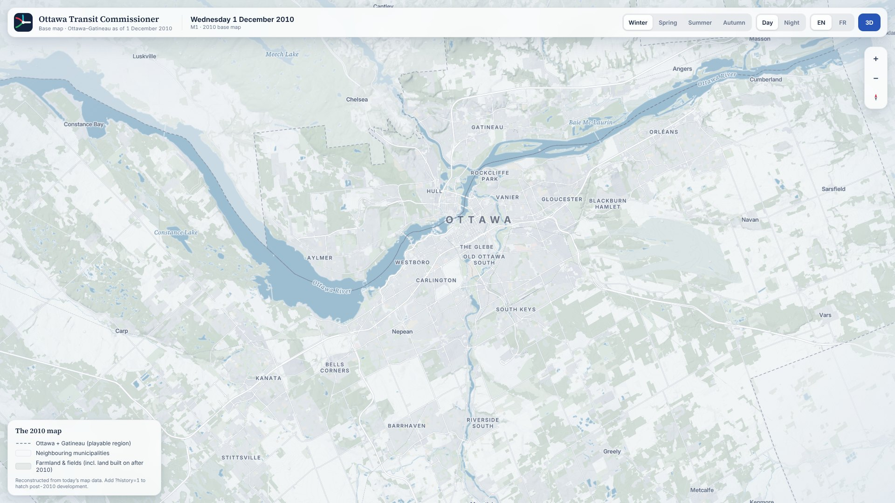 | 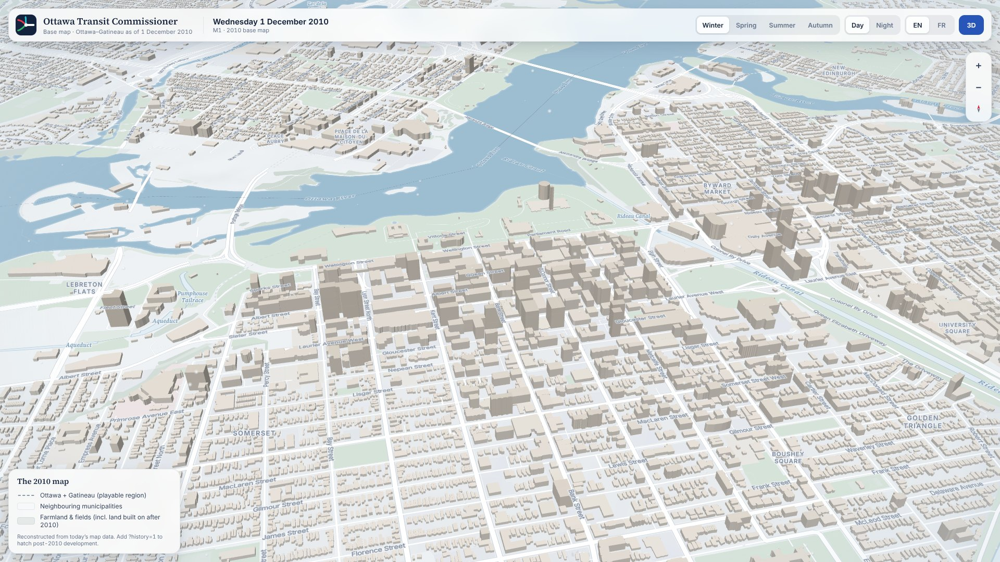 |
| Winter overview: the playable region, with neighbouring municipalities faded | Downtown in 3D, with real building heights |
| 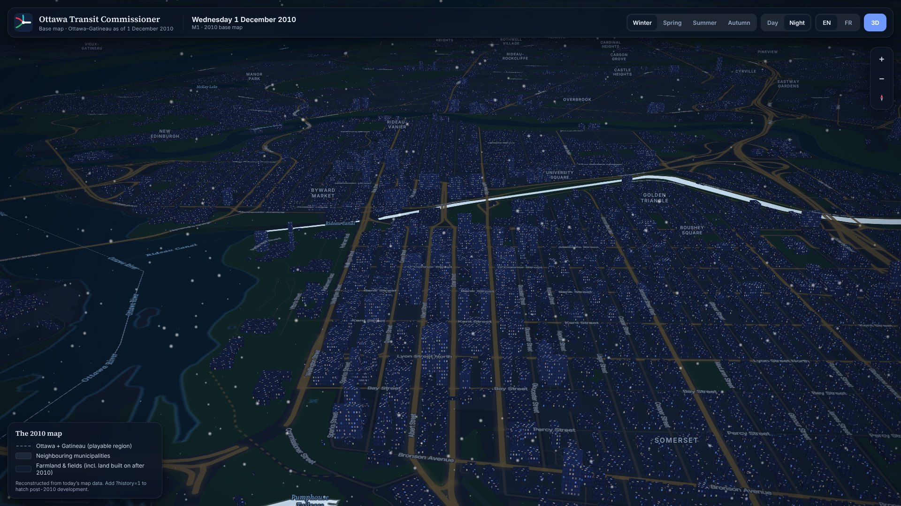 | 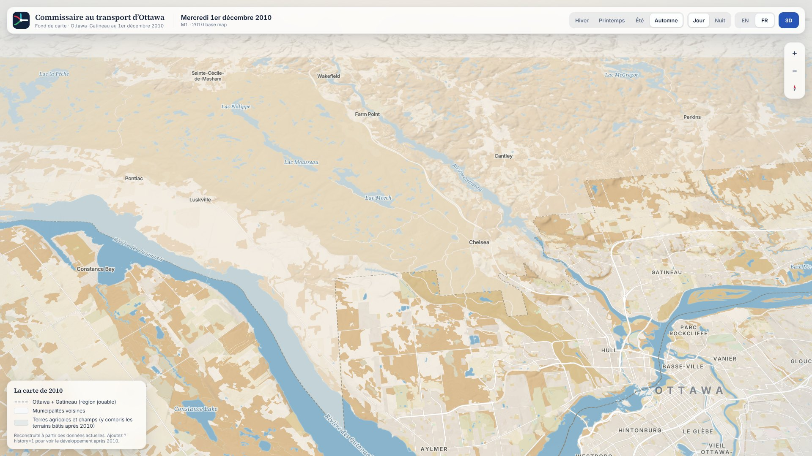 |
| Winter night: lit windows and the Skateway | Autumn, in French: hillshading from NRCan elevation |
| 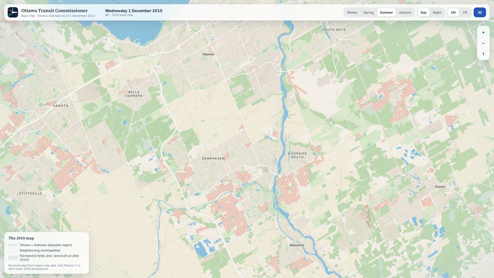 | 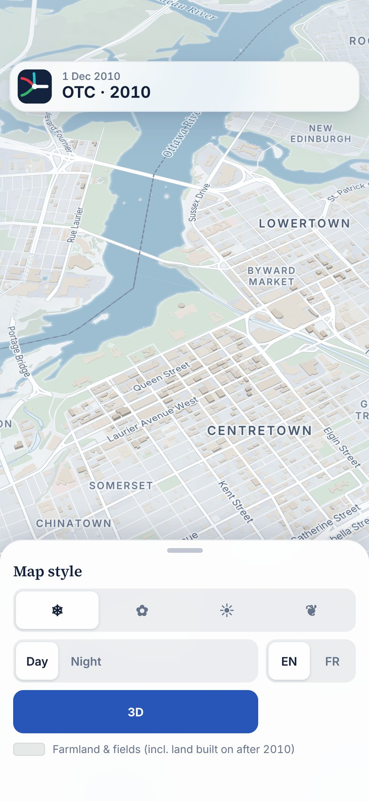 |
| `?history=1`: post-2010 development hatched (review aid) | Phone layout |

**Differences from the prototype:**

- Labels are real map symbols with collision handling, using generated Inter and Source Serif 4
  glyphs instead of an HTML overlay.
- **Built-up areas are tinted** at regional zoom, cut back to their 2010 extent.
- Farmland gets a seasonal tone.
- Land developed after 2010 is shown as ordinary fields, because in a player-driven 2010 the
  future isn't given away. `?history=1` reveals it for review.

